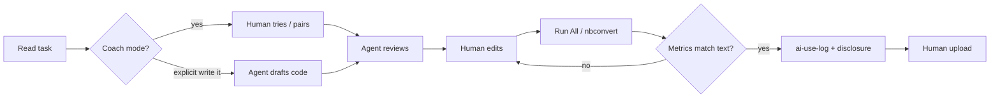

# How I work with AI agents on coursework

**Fact:** AI is allowed in this Arcada course when I name the tool and model. I keep logs and disclosure cells, not just chat memory.

## Roles

| Role | Who | Responsibility |
|---|---|---|
| Decision owner | Human (me) | Approach, what to submit, final review, Run All |
| Study partner | Claude Code / claude.ai | Early blocks: setup, coach mode, some full solves on request |
| Implementation agent | Cursor agents | Block 2: hands-on 3 and 4, homework 2, this public packaging |
| Auditor | Same agents + me | Pre-submit nbconvert, compare metrics to text |

## Gates

1. **Coach mode** (`CLAUDE.md`): no silent full solves.
2. **`ai-use-log.md`:** per assignment table of ask, AI output, human edits.
3. **Disclosure cell:** last cell in each submit notebook (private until published).
4. **Pre-submit:** `nbconvert --execute` on submit paths before itslearning upload.

## Loop (Mermaid)

## Real catches (from logs, not invented)

**Hands-on 2 (HO2):** Disclosures said the test set is for final scoring only, but the notebook scored the test set twice (before and after tuning). Claude Code flagged the wording mismatch. **Lesson:** deployment-style discipline starts in notebooks, not only in production.

**Homework 1 (HW1):** Task 3a used Matplotlib `orientation='horizontal'` on `boxplot`, which needs Matplotlib 3.10+. My older Jupyter kernel failed. Fix: default-orientation boxplot; numbers unchanged. **Lesson:** environment pins and a clean run on target versions.

**This showcase:** `prompts/06-cursor-github-showcase.md` was drafted with Claude Code; a Cursor agent ran the export and docs. **Fact:** multi-agent handover with explicit prompts.

## Provenance

See README provenance table and `docs/cursor/README.md` for commit trailers and logs.
